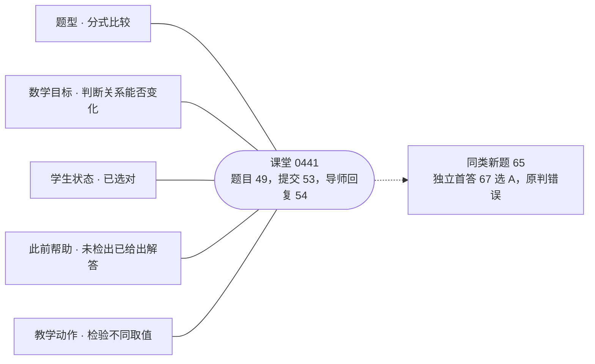

# TutorSkillGraph 的超图与教学 skill 演化

导师要学会一个具体决定。学生刚给出答案时，这次该用什么材料检验他的想法，哪一步该留给他自己做，看到什么表现就可以往下教？系统把可以反复使用的教学动作称为 **skill**，例如“请学生找一个满足题设、又能推翻当前大小判断的取值”。一条教法有适用条件，也有能使导师收回补教建议的证据。

## 为什么把一次教学决定存成一条超边

同一组数既可以由老师算给学生看，也可以让学生用它检验自己的猜想。两次课都有“分式题”“举例”“答对”这些标签，留给学生的思考却不同。我们把一次教学中共同出现的角色连到**同一条超边**。这样，检索时可以要求“这道题允许关系变化”“这个学生目前只报选项”“导师此前透露了多少”同时成立，也能回到当时的原话。

当前有两种相互关联的记录，分别用于保存教法版本和检索课堂片段。

| 记录 | 节点是什么 | 一条超边是什么 | 挂在边上的信息 |
| --- | --- | --- | --- |
| 教法版本 `LessonVersion` | 教学 skill、材料、可见条件、预期的学生步骤、来源课堂 | 针对这类表现，怎样选材，怎样把指定步骤留给学生 | 版本 ID、父版本、教案文字、原话位置、竞争解释、撤回条件 |
| 课堂片段 `Episode` | 题型、数学目标、可见学生状态、此前帮助、候选教学动作 | 在某道已展示的题上，学生一次发言或提交与紧接的导师回复形成的教学时点 | 场次和话轮位置、关联的独立新题与首次作答、可对应的教法版本 |

节点用“角色、取值”这对字段标识。程序保存每个节点关联的超边编号，检索时取编号集合的交集。例如下面五个节点都连到 0441 的同一课堂片段。实线表示角色归属，虚线指向这一时点之后才出现的证据。日志中导师的实际回复可按位置 54 查阅，边上的候选动作由程序依据可见状态赋予。[版本图代码](src/tutorskillgraph/skill_graph.py) · [课堂图代码](src/tutorskillgraph/grounded_skill.py) · [0441 原始轨迹](data/raw/studentbench-reasons/task_id_0441.csv)

首版从 12 场课保存了 12 条原教案和 12 条候选修订，共 51 个带角色的节点。扩展后的课堂图从 63 场课、276 道已展示的练习取得 574 条片段超边，连接 24 个不同的角色取值。这里的一条边代表一个课堂时点，一名学生可以贡献多条边。[版本图快照](experiments/reason_ablation/native_runs/skill_graph.json) · [课堂图快照](experiments/grounded_tutor/memory.json)

## 教学 skill 如何演化

1. **保留原教法和它留下的问题。** 在 0402 的原版本 `task_id_0402/lesson/1/v1` 中，导师用合法数值比较幂的大小。后来在第 15 个事件展示的新题上，学生于事件 16 明确写出自己认为指数较大就一定更大。这句理由把需要检验的想法具体到了“只看指数”。[0402 原始轨迹](data/raw/studentbench-reasons/task_id_0402.csv)
2. **只改能区分两种理解的一步。** 0402 的候选 `v2` 指向上述 `v1`。它保留“让学生找能改变结果的取值”这一步，把材料改成分别在 1 两侧选正底数。例如比较 x³ 与 x²，x=2 时前者较大，x=1/2 时前者较小。若学生在无提示的新题上已能说明后者及其原因，就撤回针对他的这项补教。候选的父版本、学生原话和撤回条件都保存在同一记录中。[0402 改课决定](experiments/reason_ablation/runs/text/task_id_0402_reason.json) · [版本记录](experiments/reason_ablation/native_runs/skill_graph.json)
3. **把证据接回产生它的课堂。** 在扩展课堂图中，系统查找同一场次、同概念、同题型的另一道题，只使用该新题首次导师反馈前的学生作答。168 条片段能关联到 72 次不同的独立表现。用于大小比较的具体修订，会把共享同一次后续作答的片段归到最近一次对应往返。最后有 62 对可核验的选项提交，学生先选对 D，后来独立做同类题时有 47 次仍选 D，另外 15 次选了固定关系。选项是观测记录，学生是否漏掉另一种可能需要通过新题核验。[独立作答与原话位置](experiments/evidence_revision/history.json)
4. **在新课上选择能检验该判断的材料。** 普通检索先匹配数学目标、学生状态、题型和已有帮助。匹配不足时先放宽帮助条件，再放宽题型，始终保留目标和学生状态。对于关系可变且学生只报选项的题，若他选 A、B 或 C，就优先检验他刚选的关系。若他只选 D，则参考相似旧题中不同学生后来独立选过的固定关系，优先同题型、已核验的大小关系集合也相同的案例。一名历史学生对同一选项只计一票。程序再从当前题满足约束的取值中找出一对不同结果，把尚待完成的计算交给学生。[检索与取值](src/tutorskillgraph/grounded_skill.py) · [独立作答怎样改变选材](src/tutorskillgraph/evidence_revision.py)

理由与结论的证据强度决定了能改多少。如果只有一个正确字母，可以先取得一次独立解释。如果学生已经独立说明关键关系，可以保留原教法并结束补问。如果有具体理由指向某种错误概括，可以像 0402 那样只改材料。p019 的真实日志只有提示后的单门方程和三道变式题的合计成绩，双门题的回答与理由未知。它的“双门对照”保留为待检验的候选。[p019 的实际记录、两种预测与撤回条件](cases/p019.zh-CN.md)

## 一次实际使用与评估

在留出课堂 0664，学生选 A，认为 x−y 大于 0。题设为 (x−4)(x+1)=0、x+y=2。系统能验证两组取值：x=4、y=−2 时 A 成立，x=−1、y=3 时符号反过来。修订教案让导师给出第二组取值，把“−1−3 和 0 谁大”留给学生。该次检索实际关联到 0441、0545、0649 三场旧课的独立作答，学生这次选的 A 则来自他刚刚的提交。[0664 的教案、取值和证据编号](experiments/evidence_revision/runs/design_lock.json) · [两组实际回复](experiments/evidence_revision/runs/comparisons.json)

最终回话仍采用 StudentBench 发布的 `gre.quant.tutor.lean.v3` 策略。两组读同一份学生资料、原教案和截至当时的对话，使用同一个 `gpt-6-luna`。TutorSkillGraph 将选好的教学步骤写入原教案的 `why_it_matters` 槽。研究执行者在隐藏教案来源后，按提前写定的目标评价下一条回复。[重放实现](src/tutorskillgraph/grounded_trials.py)

| 独立评估批次 | StudentBench 原教案达标 | TutorSkillGraph 教案达标 |
| --- | ---: | ---: |
| 32 场，每场一个时点，按课堂状态检索和选材 | 17/32 | 23/32 |
| 另外 24 场，加入由后续独立作答修订的选材规则 | 11/24 | 19/24 |

第二批中有 6 场触发了新补问，这 6 场两组分别为 3/6 和 6/6。两轮的结果衡量整套教案对下一句回复的作用。第一批 32 场中，同样字段的条件表与超图逐例给出了相同教案。超图在此承担组合检索和证据追溯，各场的实际学生表现来自发布的原课堂。[32 场报告](experiments/grounded_tutor/REPORT.zh-CN.md) · [24 场报告](experiments/evidence_revision/REPORT.zh-CN.md)

## 设计参考

Ming Li 等人的 EduLLM 用学生、题目和作答记录构造带符号的超图来预测表现。这里借鉴的是把一次有上下文的教育交互作为有明确含义的关系来建模。Voyager 展示了如何保存和检索可复用技能，以及如何用环境反馈修改技能。在本项目里，可复用的是教学动作，反馈取自可定位的后续独立作答，修改的对象是下一次授课的触发条件、材料或留给学生的步骤。[EduLLM，ICML 2025](https://proceedings.mlr.press/v267/li25e.html) · [Voyager 原论文](https://arxiv.org/abs/2305.16291)
